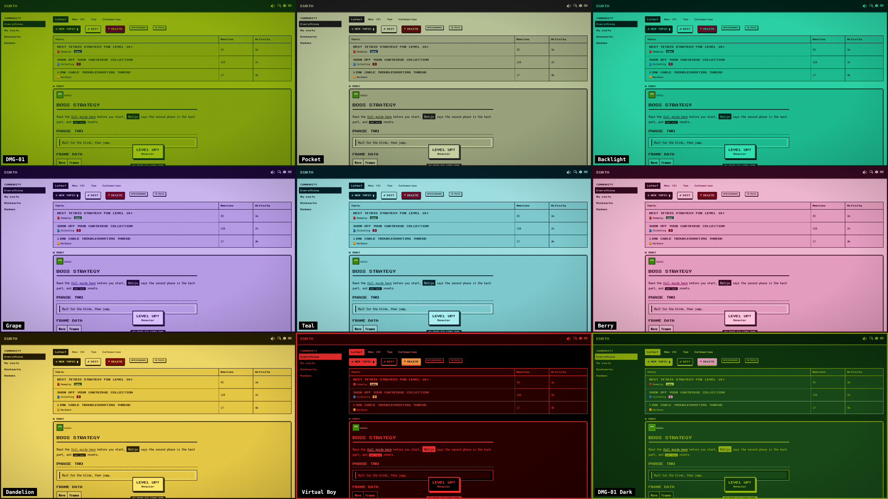

# Game Boy Classic

A four-shade, 8-bit theme for [Discourse](https://www.discourse.org), inspired by the original 1989 handheld. It ships with the pixel font, square corners, chunky borders, "pressable" buttons and a Konami-code easter egg.

Built for [Eurth](https://eurth.org).

## What it does

- **Nine palettes.** DMG-01 (the original greens, default), DMG-01 Dark, Pocket, Backlight, Grape, Teal, Berry, Dandelion and Virtual Boy. Switch in **Admin → Appearance → Colors**. Every shade in the stylesheet reads from the active palette, so you can also make your own.
- **Readable by design.** Text is always the darkest shade on the lightest or middle one (6:1 on DMG-01), links are underlined, and hover states invert instead of fading. `pnpm lint:contrast` fails the build if any bundled palette drops below WCAG AA (4.5:1).
- **Two pixel fonts.** Press Start 2P for headings and controls, VT323 for posts and forms. Both are bundled, so visitors' browsers never contact Google Fonts.
- **Colour where it means something.** Unread and error badges, the like heart and danger buttons use the console's button colours. New-topic badges use the success colour. Each category gets a little cartridge marker in its own colour.
- **Handheld feel.** An LCD pixel grid and vignette, a bezel with a power light, stair-stepped pixel corners, 8×8 pixel icons, and a pixel ▶ cursor on the topic row under the mouse.
- **Game UI.** Dialog titles type themselves out, the reading-progress bar is segmented like an HP bar, missing pages say GAME OVER, and earning a badge pops a LEVEL UP toast.
- **Sound.** Optional chiptune beeps for buttons, likes, posts, notifications and badges, generated in the browser. Off until a member turns it on with the speaker button in the header.
- **Also:** green-tinted images, logo boot animation, blinking cursor and a Konami-code confetti easter egg.

Animations only run for visitors who haven't turned on "reduce motion" in their operating system. The LCD grid switches off for visitors who ask for more contrast.



## Install

**Admin → Appearance → Themes → Install → From a git repository**, then paste:

```
https://github.com/stijn/discourse-game-boy-classic-theme
```

While the repository is private, tick **Private repository**. Discourse will show a public key. Add it on GitHub under the repository's **Settings → Deploy keys** (read-only), then finish the install in Discourse.

After installing, open the theme and:

1. Set **Color palette** to **DMG-01** (or any other bundled palette). For a dark mode, set the dark palette to **DMG-01 Dark**.
2. Add any components you want under **Included components**.
3. Tick **Selectable by users** if members should be able to pick it in their preferences.

Updates: open the theme and click **Check for updates**, or enable automatic updates.

## Settings

All settings are on by default.

| Setting | What it does |
| --- | --- |
| `uppercase_text` | Headings, topic titles, buttons and tags in capitals |
| `readable_body_font` | Posts and forms in VT323 instead of Press Start 2P |
| `camera_filter` | Tints avatars, logos and post images green |
| `boot_animation` | Drops the site logo in on page load |
| `blinking_cursor` | Blinking block cursor on the New Topic and Reply buttons |
| `lcd_screen` | Faint pixel grid and screen vignette |
| `bezel` | Handheld frame around the page, with a power light |
| `pixel_corners` | Stair-stepped corners on buttons, posts, notices and dialogs |
| `pixel_icons` | 8×8 pixel versions of common icons |
| `menu_cursor` | Pixel ▶ beside the topic row under the mouse or keyboard focus |
| `category_cartridges` | Category colour markers drawn as cartridges |
| `game_ui` | Typewriter dialog titles, HP-style progress bar, GAME OVER page, LEVEL UP toast |
| `sound_effects` | Lets members switch on chiptune beeps (still off until they do) |
| `konami_confetti` | Typing ↑ ↑ ↓ ↓ ← → ← → B A outside a text field fires square confetti in the palette colours. The confetti script loads only at that moment. |

## Repository layout

Follows the official [Discourse theme skeleton](https://github.com/discourse/discourse-theme-skeleton):

```
about.json                  Theme metadata, bundled assets, the nine palettes
settings.yml                Theme settings
locales/en.yml              Theme description and setting labels
common/common.scss          All styles (desktop and mobile)
javascripts/discourse/
  api-initializers/
    konami-confetti.js      Easter egg
    sound-effects.js        Chiptune beeps and the header speaker button
    level-up-toast.js       LEVEL UP toast on badge notifications
  lib/gb-sound.js           Square-wave beep player
assets/                     Bundled fonts and confetti script
scripts/
  check-contrast.mjs        Fails if a palette has unreadable text pairs
  gen-pixel-icons.mjs       Draws the pixel icons into common.scss
  preview/                  Mock Discourse page and the screenshot renderer
screenshots/                Theme previews (1600×900 and a palette grid)
licenses/                   Third-party licences
spec/system/                Discourse core-feature smoke tests (run in CI)
```

## Development

Requires Node 22+ and pnpm.

```sh
pnpm install
pnpm lint        # ESLint, Stylelint, Prettier
pnpm lint:fix
pnpm lint:contrast   # also part of pnpm lint
pnpm icons           # redraw pixel icons after editing scripts/gen-pixel-icons.mjs
node scripts/preview/render.mjs   # redraw screenshots/
```

The screenshots are the theme's real stylesheet rendered over a small mock of Discourse's markup, not a live site. Rules aimed at parts of Discourse the mock doesn't contain (sidebar, user menu, select-kit dropdowns, the topic timeline, the 404 page, chat) are written against Discourse's class names but have not been checked on a running install, so look at those first after updating.

For live editing against a site, use the [`discourse_theme`](https://meta.discourse.org/t/82950) CLI:

```sh
gem install discourse_theme
discourse_theme watch .
```

GitHub Actions runs the linters and Discourse's core-feature system specs on every push to `main` and on pull requests.

## Credits

- [Press Start 2P](https://github.com/google/fonts/tree/main/ofl/pressstart2p) by CodeMan38. SIL Open Font License 1.1.
- [VT323](https://github.com/google/fonts/tree/main/ofl/vt323) by Peter Hull. SIL Open Font License 1.1.
- [canvas-confetti](https://github.com/catdad/canvas-confetti) 1.9.3 by Kiril Vatev. ISC License.

Not affiliated with or endorsed by Nintendo. Game Boy is a trademark of Nintendo.

## License

[MIT](LICENSE) © 2026 Stijn Vogels. Bundled third-party files keep their own licences; see [`licenses/`](licenses/).
